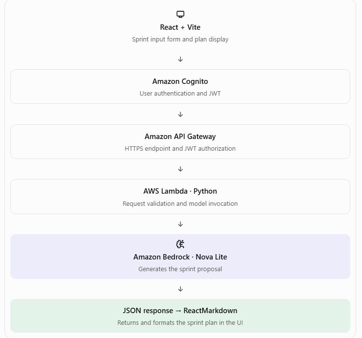
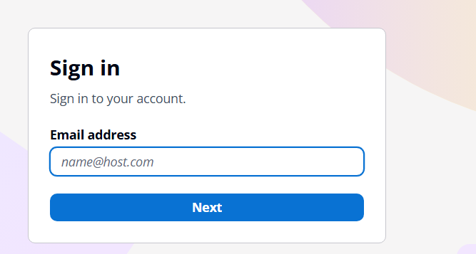
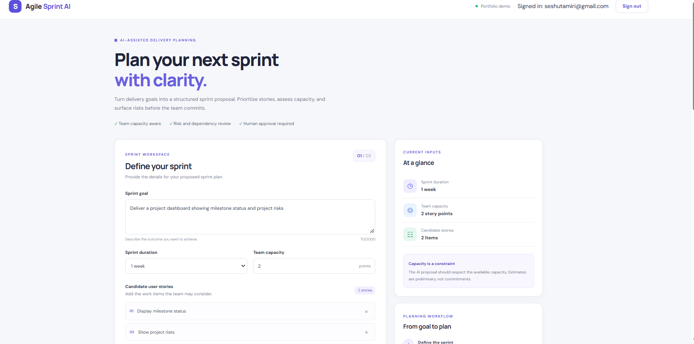
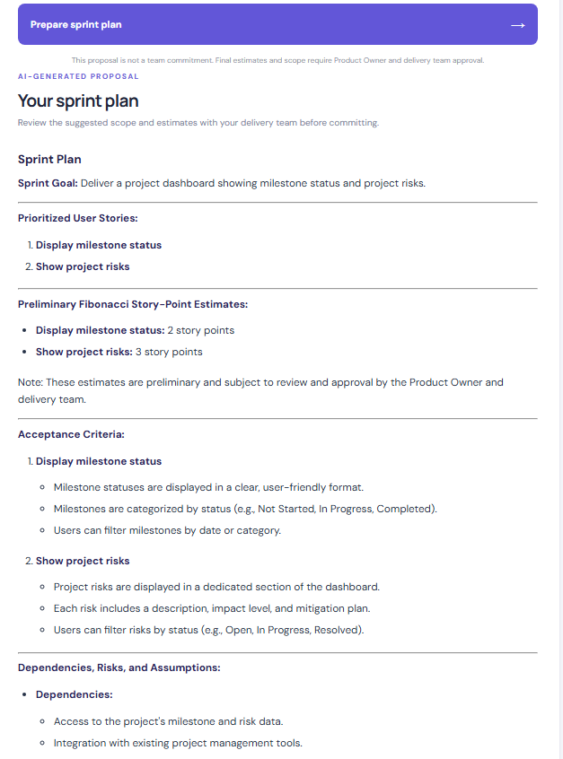
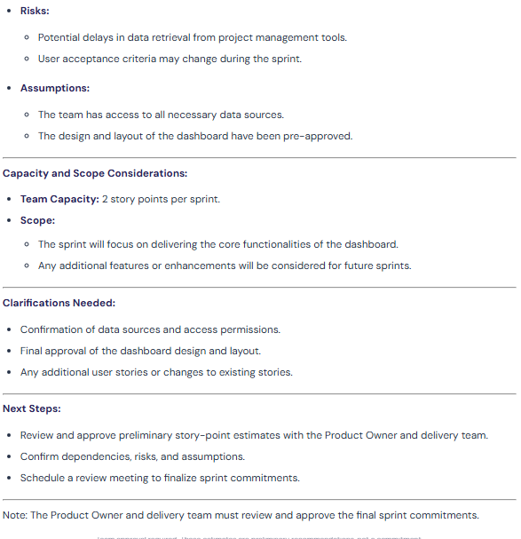

# Agile Sprint Planning AI Assistant

An AI-powered Agile sprint planning application that helps delivery teams transform sprint goals, team capacity, and candidate user stories into a structured sprint plan using Amazon Bedrock.

The application combines a React frontend, Amazon Cognito authentication, Amazon API Gateway, AWS Lambda, and Amazon Bedrock Nova Lite. It is designed to support planning decisions while keeping final scope, estimates, and sprint commitments under human control.

## Live Demo

- **Application:** [Agile Sprint AI](https://d2czvjyj1j00nt.cloudfront.net/)
- **Source code:** [GitHub Repository](https://github.com/seshutamiri-rgb/agile-sprint-ai-frontend)
- **AWS Region:** Asia Pacific (Sydney) — `ap-southeast-2`

> Note: The live demo depends on the availability and configuration of the AWS resources backing the application.

## Project Overview

Sprint planning requires teams to balance business priorities, candidate stories, delivery capacity, dependencies, and risks. This application provides an AI-assisted approach to generating an initial sprint plan from structured inputs.

The user supplies:
- Sprint goal
- Sprint duration
- Team capacity in story points
- Candidate user stories

The backend validates the request and sends a prompt to Amazon Bedrock. The generated plan includes prioritized stories, preliminary Fibonacci estimates, acceptance criteria, dependencies, risks, assumptions, capacity considerations, and clarification questions.

The output is a planning recommendation, not an automatically approved sprint commitment.

## Key Features

- **Authentication:** Sign in and sign out using Amazon Cognito.
- **Sprint planning:** Generate an AI-assisted plan from sprint inputs.
- **Request validation:** Validate required fields, input types, capacity, and candidate-story limits.
- **AI integration:** Use Amazon Bedrock Nova Lite through the Converse API.
- **Secure API access:** Protect the sprint-planning route using a Cognito JWT authorizer.
- **Human-in-the-loop planning:** Keep final estimates, scope, and sprint commitments subject to team review and approval.
- **Error handling:** Return structured API errors and record backend diagnostic information in Amazon CloudWatch.

## Architecture


## Application Screenshots

### 1. Sign-in



### 2. Sprint Planning Form



### 3. Generated Sprint Plan



### 4. Generated Sprint Plan



### Request Flow

1. The user opens the React application delivered through Amazon CloudFront.
2. Amazon Cognito authenticates the user.
3. The frontend sends the sprint-planning request and its authorization token to Amazon API Gateway.
4. API Gateway validates the JWT and applies the configured CORS policy.
5. AWS Lambda validates the input and constructs the prompt.
6. Lambda invokes Amazon Bedrock Nova Lite using the Bedrock Runtime Converse API.
7. The backend returns the generated sprint plan as JSON.
8. The frontend displays the plan for review by the Product Owner and delivery team.

### AWS Components

| Component | Responsibility |
|---|---|
| Amazon S3 | Stores the production frontend files in a private bucket. |
| Amazon CloudFront | Delivers the frontend over HTTPS. |
| Amazon Cognito | Manages user authentication. |
| Amazon API Gateway HTTP API | Exposes the sprint-planning endpoint and validates JWTs. |
| AWS Lambda | Validates requests, constructs prompts, invokes the model, and returns responses. |
| Amazon Bedrock | Generates the sprint plan using Nova Lite. |
| AWS IAM | Controls Lambda execution permissions and access to Bedrock. |
| Amazon CloudWatch | Stores Lambda execution logs for troubleshooting. |

## Technology Stack

### Frontend
- React
- Vite
- JavaScript
- `oidc-client-ts` for the Cognito authentication flow
- React Markdown rendering for the generated sprint plan

### Backend
- Python
- AWS Lambda
- `boto3`
- Amazon Bedrock Runtime — Converse API

### Cloud and Security
- Amazon S3
- Amazon CloudFront
- Amazon Cognito
- Amazon API Gateway HTTP API
- AWS IAM
- Amazon CloudWatch

## API Reference

### Generate a Sprint Plan

**Method:** `POST`

**Endpoint:**

`https://4z32vuj7sf.execute-api.ap-southeast-2.amazonaws.com/plan-sprint`

**Authentication:** Cognito JWT bearer token required.

**Headers:**

```http
Content-Type: application/json
Authorization: Bearer <COGNITO_ACCESS_TOKEN>
```

**Example request:**

```json
{
  "sprint_goal": "Deliver the initial customer dashboard",
  "sprint_duration": "2 weeks",
  "team_capacity_points": 30,
  "candidate_stories": [
    "Implement user login",
    "Build the customer dashboard",
    "Add dashboard filtering",
    "Write automated tests"
  ]
}
```

**Example response structure:**

```json
{
  "status": "success",
  "sprint_plan": "Generated sprint plan in Markdown...",
  "requires_team_approval": true
}
```

The `sprint_plan` value contains the AI-generated content. The response shown above is illustrative; the actual plan depends on the supplied inputs and model output.

## Input Validation and Error Handling

The Lambda backend validates incoming requests before invoking the AI model.

Current validation includes:
- A non-empty sprint goal, limited to 2,000 characters.
- A positive integer for team capacity.
- A list of non-empty candidate-story strings, limited to 50 stories.
- A non-empty sprint duration.

The backend handles malformed JSON, invalid inputs, Bedrock client errors, empty model responses, and unexpected exceptions using structured JSON responses.

The application uses HTTP status codes to distinguish client input errors from backend or AI-service failures.

## Security Design

Security is an important part of the application architecture.

- **Authentication:** Amazon Cognito handles user sign-in and sign-out.
- **API authorization:** API Gateway uses a JWT authorizer on `POST /plan-sprint`.
- **Transport security:** The frontend and API use HTTPS.
- **Cross-origin access:** API Gateway CORS permits the deployed CloudFront origin and the local development origin.
- **IAM least privilege:** The Lambda execution role uses a logging policy and a Bedrock invocation policy restricted to the Nova Lite foundation model.
- **Configuration:** Frontend configuration is supplied through environment variables. Local `.env.local` files should not be committed to Git.
- **Diagnostics:** Lambda logs are available through Amazon CloudWatch.

The frontend must not contain AWS secret access keys or other privileged credentials. Authentication tokens should not be copied into logs, screenshots, or documentation.

## Local Development Setup

### Prerequisites

- Node.js and npm
- Git
- Visual Studio Code or another code editor
- An AWS account with the required resources configured
- A configured Amazon Cognito app client
- Access to the deployed API Gateway endpoint and Bedrock model

### 1. Clone the repository

```bash
git clone https://github.com/seshutamiri-rgb/agile-sprint-ai-frontend.git
cd agile-sprint-ai-frontend
npm install
```

### 2. Configure frontend environment variables

Create a local `.env.local` file in the project root.

Use the actual values from your Cognito app client and deployment configuration:

```dotenv
VITE_COGNITO_REGION=ap-southeast-2
VITE_COGNITO_USER_POOL_ID=<YOUR_COGNITO_USER_POOL_ID>
VITE_COGNITO_CLIENT_ID=<YOUR_COGNITO_APP_CLIENT_ID>
VITE_COGNITO_DOMAIN=<YOUR_COGNITO_DOMAIN_URL>
VITE_REDIRECT_URI=http://localhost:5173/
VITE_LOGOUT_URI=http://localhost:5173/
```

For local development, register `http://localhost:5173/` in the Cognito app client's allowed callback and sign-out URLs.

For the deployed application, use the CloudFront URL in the corresponding Cognito configuration.

Do not commit `.env.local` or put secrets in frontend environment variables. Vite variables prefixed with `VITE_` are exposed to the browser bundle and must not contain privileged secrets.

### 3. Start the development server

```bash
npm run dev
```

Open the local URL printed by Vite, usually:

`http://localhost:5173/`

### 4. Build the production frontend

```bash
npm run build
```

Vite writes the production build to the `dist/` directory.

To deploy, upload the **contents of `dist/`** to the root of the configured S3 bucket, then invalidate the CloudFront cache when required.

## Deployment Summary

The production frontend is deployed through a private S3 bucket and CloudFront distribution.

The backend is deployed as an AWS Lambda function named `AgileSprintAI-Backend`. API Gateway exposes the `POST /plan-sprint` route and uses the Cognito JWT authorizer. Lambda invokes Amazon Bedrock Nova Lite in the Sydney region.

After a frontend deployment, verify that CloudFront serves the current production `index.html` and its matching hashed JavaScript and CSS assets. If the previous build remains cached, create a CloudFront invalidation for the required paths.

## Monitoring and Troubleshooting

Use Amazon CloudWatch to inspect Lambda execution logs.

Typical troubleshooting areas include:

- **401 or 403 responses:** Verify the Cognito token, JWT issuer, audience, and route authorization configuration.
- **CORS errors:** Verify API Gateway's allowed origins, methods, and headers.
- **AI-service errors:** Check the Lambda execution role, Bedrock model access, model identifier, and CloudWatch logs.
- **Timeouts:** Review the Lambda timeout and observed execution duration.
- **Stale frontend assets:** Verify the S3 production files and CloudFront cache invalidation status.

The Lambda function is configured with a 30-second timeout. Actual execution time depends on the request and model response.

## Current Scope and Limitations

This version focuses on AI-assisted sprint planning from user-provided inputs.

- Sprint plans are generated on demand.
- The application does not currently persist sprint plans in a database.
- It does not automatically synchronize with Jira, Azure DevOps, or other project-management platforms.
- Story estimates and prioritization are AI-generated recommendations and require human review.
- Production monitoring, automated deployment pipelines, and broader operational controls can be extended in future iterations.

## Future Enhancements

Potential next improvements include:

- Persistent sprint history and plan comparison.
- Integration with Jira or Azure DevOps.
- Team-specific velocity and historical delivery data.
- Improved dependency and risk analysis.
- Automated testing and CI/CD deployment.
- Usage monitoring, cost tracking, and operational dashboards.
- Role-based access for Product Owners, Scrum Masters, and delivery teams.

## Interview Demonstration

A short demonstration can follow this sequence:

1. Open the deployed application and sign in.
2. Enter a sprint goal, duration, team capacity, and candidate stories.
3. Generate and review the proposed sprint plan.
4. Explain how request validation and JWT authorization protect the API.
5. Walk through the flow from API Gateway to Lambda and Amazon Bedrock.
6. Explain why the final sprint commitment remains subject to human approval.
7. Show CloudWatch logs as evidence of backend execution and troubleshooting.

## Project Objective

This project demonstrates how enterprise delivery-management practices can be combined with generative AI and cloud services to assist with planning, improve visibility, and support informed decisions while maintaining human accountability for delivery commitments.
